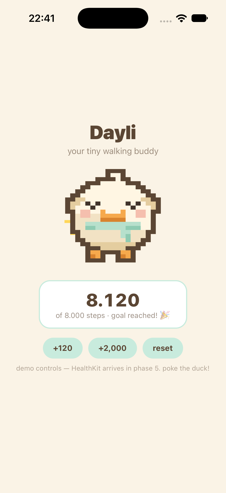

# mascots

Animated pixel-art mascots for agent-built apps. This repo provides the
**`/mascot` skill**: point it at any React Native/Expo app and an animal, and
it designs an original pixel mascot (pixel maps — no image-gen AI), generates
sprite frames with a zero-dependency engine, animates it with a drop-in
`PixelPet` component (idle · blink · glance · waddle · celebrate · poke), and
verifies every state with simulator screenshots before calling it done.

<p>
  
</p>
<p>
  
</p>

The duck above is the reference pack — every art decision lives in
[`skills/mascot/scripts/packs/duck.mjs`](skills/mascot/scripts/packs/duck.mjs),
and regenerating it reproduces these PNGs byte-for-byte.

## Install

**skills CLI** (Claude Code, ZCode, Codex, Cursor, …):

```bash
npx skills add DayliTracker/mascots
```

**Claude Code plugin marketplace:**

```bash
/plugin marketplace add DayliTracker/mascots
/plugin install mascots@mascots
```

**Manual:** copy `skills/mascot/` into your project's `.claude/skills/` (or
`.zcode/skills/`).

## Run it

```
/mascot            # asks which animal + name
/mascot cat        # skips the animal question
```

The skill interviews you (animal, name, overrides), vendors the engine +
`PixelPet` into your app, designs the pack, and holds three gates before
declaring done: **art** (you approve the contact sheet), **motion** (validator
PASS + inline animation preview), **device** (per-state simulator screenshots
committed under `docs/mascots/<animal>/qa/`).

## Repo layout

```
skills/mascot/            # the skill (SKILL.md + references + engine scripts)
├── scripts/engine.mjs    # pixel-map → PNG, zero deps, deterministic
├── scripts/validate-frames.mjs   # delivery gate: palette lock, registration, determinism
├── scripts/packs/duck.mjs        # reference pack — copy its shape for new animals
├── references/           # pipeline, animal recipes, craft, QA protocol, integration
└── assets/palettes.json  # DB16 / DB32 / Endesga 32 / Resurrect 64 / cozy
react-native/PixelPet.tsx # the animator (core Animated, no extra deps)
```

## Craft sources

The baked-in rules come from Derek Yu's pixel-art tutorial, Slynyrd
Pixelblogs 1/5/6/8, and Lospec palettes — links inline in
[`skills/mascot/references/craft.md`](skills/mascot/references/craft.md).

## License

MIT
